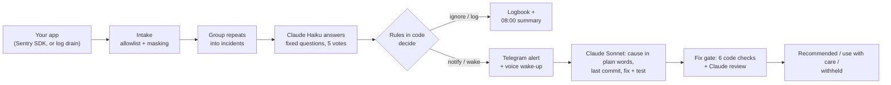
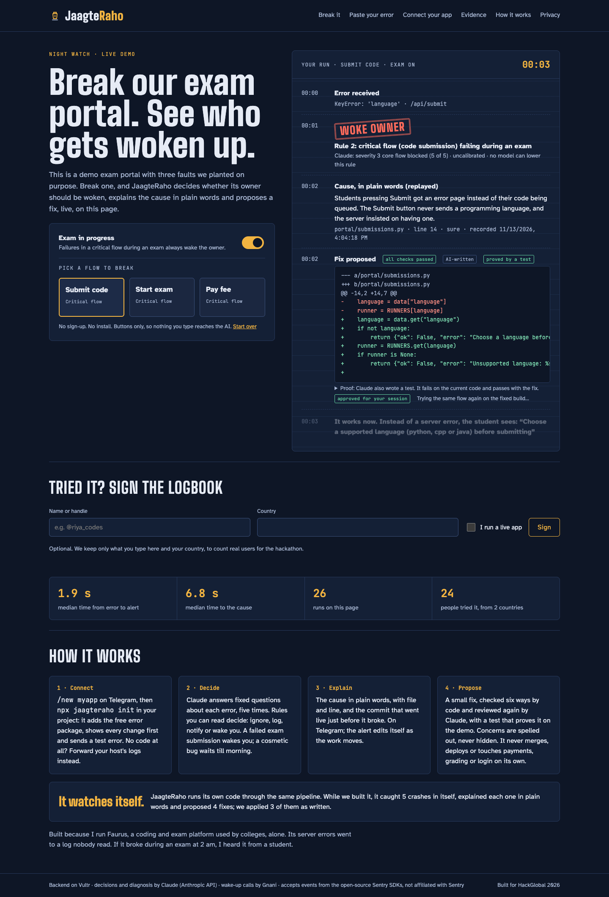
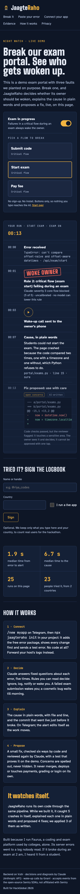
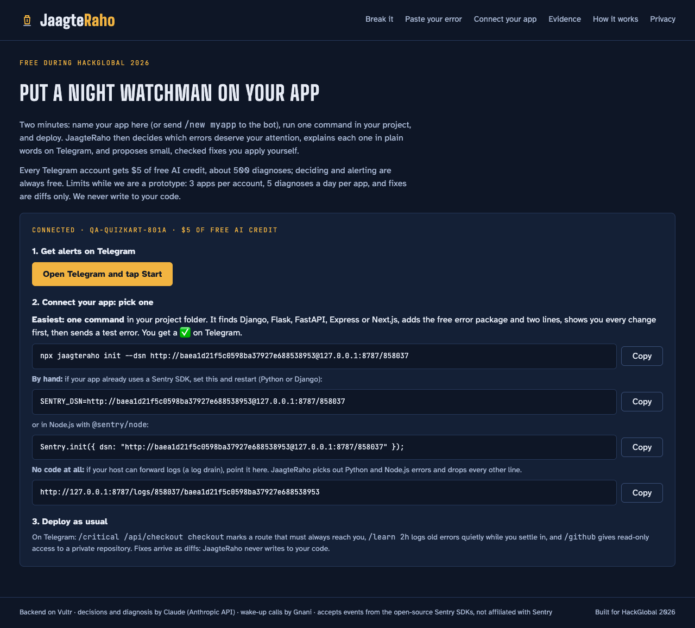
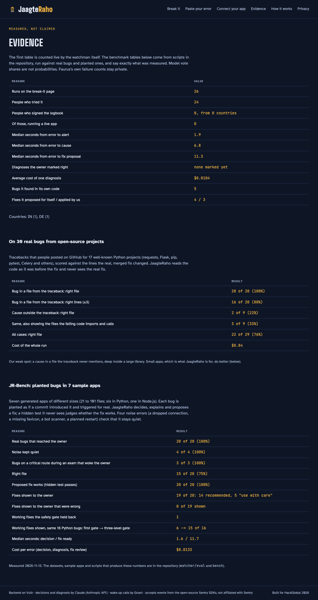
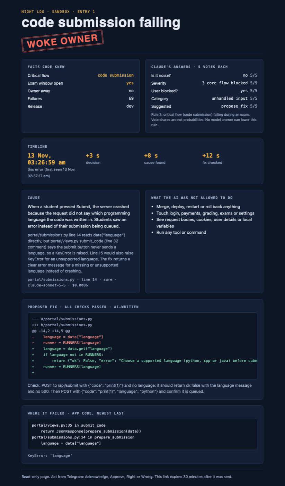
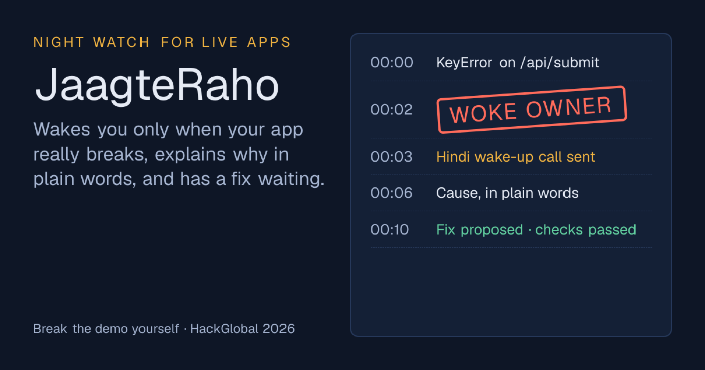

# JaagteRaho

**Your app breaks at 2 am. If you don't wake up, JaagteRaho heals it.**

**You approve every fix, or let it heal on its own under rules you set.**

An AI on-call agent for people who run a live app alone. It reads every error from your app, wakes you only when real users are hurt, tells you the cause in plain words with the file and line, and writes a fix that must pass six code checks and a review. If you sleep through the wake-up and your rule allows it, the fix goes in on its own as a pull request that merges only behind your required checks; if the errors don't drop after your deploy, it is rolled back and you are woken again.

**Measured on 13 Nov 2026, by scripts in this repository, mistakes included:** 20 of 20 planted bugs reached the owner · 0 wrong fixes among the 19 shown · 4 of 4 harmless errors kept quiet · 1.6 s median to a decision, 11.7 s to a checked fix · about $0.013 per error. [How each number was measured](#measured).

- **Live demo:** _link added at deployment_. Break a demo exam portal (no sign-up) and watch the whole loop with a timer.
- **Demo video (2:45):** _link added at submission_
- **Paste your error:** _link added at deployment_. Diagnose a Python or JavaScript error from your own public repository.
- **Connect your app:** _link added at deployment_. Run one command, or send `/new` in Telegram.
- **Evidence:** _link added at deployment_. Every number below, with how it was measured.
- **System design:** [docs/ARCHITECTURE.md](docs/ARCHITECTURE.md)

Built for HackGlobal 2026 (Track 01, Agentic and GenAI apps) by Anant Vardhan Pandey.

## Why: I am the person it wakes

I run [Faurus](https://faurus.app), a coding and exam platform that colleges use. It has about 11,000 accounts and one engineer: me.

Its server errors went to a log file nobody read. If something broke during a live exam at 2 am, I heard about it the next morning, from a student. By then the exam was over.

Error trackers collect errors. They do not decide which one is worth waking a tired person for, find the cause or write the fix. For one person running a live product, that is the whole job, and it happens at night.

Students, freelancers and solo founders now ship real products, often written with AI help, and nobody is on call for them after launch. JaagteRaho (Hindi for "stay awake", the night watchman's call) is the one who stays up.

## How a founder uses it

1. **Connect (two minutes).** Send `/new myapp` to the Telegram bot, or use the website's Connect page. Then, in the project folder:
   ```bash
   npx jaagteraho init --dsn <the address it gives you>
   ```
   The command finds Django, Flask, FastAPI, Express or Next.js, shows every change before writing it, adds the free open-source Sentry SDK and two lines, and sends a test error. A ✅ arrives on Telegram. Deploy as usual.
   No code at all? Point your host's log drain at the logs address instead; JaagteRaho picks out Python and Node.js errors and drops every other line.
2. **Sleep.** JaagteRaho wakes you (Telegram message plus a voice note in Hindi or English, repeated until you tap Acknowledge) only for what matters: a critical route failing during an exam, an outage, an error hitting many people. Everything else waits for the 08:00 summary.
3. **Fix.** The alert says what broke for users, why, which file and line, which recent commit probably caused it, and shows a small fix that passed six code checks and a review. On the demo portal the fix is also proved by a test that fails before and passes after.
4. **Or let it heal.** `/heal` sets your rule (also offered on the Connect page): `ask` (default: you approve every fix), `auto 10m` (heal if a wake-up is not acknowledged in 10 minutes), `now` (heal right away, optionally only on routes you name) or `off`. See [Self-healing](#self-healing).

Every Telegram account gets $5 of free AI credit (about 500 diagnoses); deciding and alerting are always free. `/github` gives read-only access to a private repository; self-healing needs write access you give separately (below).

## Self-healing

You approve every fix, or let it heal on its own under rules you set ([`heal.ts`](watcher/src/pipeline/heal.ts), tests in [`heal.test.ts`](watcher/test/heal.test.ts)).

- **Only recommended fixes** heal on their own: all six code checks passed and, on a real app, every review vote agreed. A fix that adds an import, a network call, a process, a file write, dynamic code, decoding or a built-up URL never does. Never in login, sessions, tokens, admin and roles, payments, exams, grading, migrations, settings and config, CI or infrastructure (`HEAL_PROTECTED` and `riskyAdditions` in [`gate.ts`](watcher/src/pipeline/gate.ts)). On the demo portal the fix must also be proved by its own regression test.
- **Only errors your server signs.** The DSN's public key ships in browsers, so it proves nothing. Self-healing acts only on incidents whose every error carried the app's server-only secret (`/heal` gives a `https://KEY:SECRET@…` DSN for Python, or an `x-jr-ingest-secret` header for Node). Other errors are still alerted and diagnosed.
- **Caps:** at most 2 heals per app in 12 hours by default (`/heal max`, up to 5).
- **How it goes in.** Demo portal: no code is written; the visitor's session switches to the portal's prebuilt fixed build and the failing request is sent again as proof. Your app: a pull request with GitHub auto-merge, turned on only when the branch requires status checks; otherwise the PR waits for you and the wake-up calls go on. This needs a write token set on the server by hand for now, bound to one repository (`JR_GITHUB_HEAL_TOKEN_<app id>` and `JR_GITHUB_HEAL_REPO_<app id>`); without it, a heal arrives as the ready-to-apply diff.
- **Proved or undone.** It waits for the deploy (a newer release reporting in, or 10 minutes after the merge without release tags), then watches the error for 30 minutes, counting only signed errors from the new release. If at least 3 come back after 10 minutes or more and they are not down by half, a revert pull request goes in, you are woken again (once) and self-healing pauses for 12 hours.
- **Told plainly.** "Healed while you were away": what broke, the cause, what changed, how it is being proved, and a one-tap Undo. Every step is in the incident's logbook.

## What happens to each error



- **Decide.** Claude answers fixed questions about each new error five times (is it noise, how severe, is a user blocked). Rules you can read in [`decide.ts`](watcher/src/pipeline/decide.ts) choose the action. A failed submission during a live exam always wakes you; a cosmetic bug waits; an error that hit 5 or more people in an hour is never silent. No model answer can lower a critical-flow alert, and a failed model call means "notify", never "ignore".
- **Explain.** Claude reads the files in the stack trace plus the files those functions import and use, and the commit that went live just before the error began.
- **Check the fix.** Six code checks (exact match, only files it was shown, at most 3 files and 40 lines, no protected areas such as login, payments or grading, no new packages or URLs, still valid code), then a Claude review. A fix every check agrees with is *recommended*; one the reviewer has concerns about is shown as *use with care* with the concerns spelled out and can never be approved with one tap; one that fails a code check or does not remove the cause is withheld.

## Measured

Every number is produced by a script in this repository. Measured 13 and 14 Nov 2026.

**JR-Bench: 20 planted bugs and 4 noise errors in 7 sample apps** ([`bench`](bench)): six Python apps of 21 to 101 files and one Node.js app. Each bug is planted as if a commit introduced it and triggered for real; a hidden test JaagteRaho never sees judges the fix.

| | Result |
|---|---|
| Planted bugs that reached the owner | 20 of 20 |
| Noise (dropped connection, favicon, bot scanner, planned restart) kept quiet | 4 of 4, at about $0.0005 each |
| Exam-time bugs on a critical route that woke the owner | 3 of 3 |
| Proposed fix works (hidden test passes) | 20 of 20 |
| Fixes shown to the owner | 19 of 20: 14 recommended, 5 "use with care"; the one withheld is in a payments module (a hard rule) |
| Fixes shown to the owner that were wrong | 0 |
| Claude's own regression test agreed with the hidden test | 14 of 14 that ran |
| Median time: decision / fix ready | 1.6 s / 11.7 s |
| Cost per error (decision + diagnosis + fix review) | about $0.013 |

What the benchmark changed: the first fix gate showed a fix only when every review answer was clean, and held back 10 of 16 fixes that were in fact correct. The three-level gate shows 15 of the same 16, still with none wrong.

**42 real bugs from 18 open-source Python projects** ([`watcher/eval`](watcher/eval)): tracebacks people posted on GitHub (requests, Flask, pip, pytest, Celery, black and others), scored against the lines the real, merged fix changed. JaagteRaho reads the code as it was before the fix and never sees the real fix. For 22 of them the fix is in code the traceback never shows; JaagteRaho then searches the repository itself (definitions, where a value is set, the error's text).

| | Result |
|---|---|
| Bug in a file from the traceback: right file | 20 of 20 (100%) |
| Bug in a file from the traceback: right lines (±3) | 17 of 20 (85%) |
| Bug in code the traceback never shows: right file | 25 of 44 diagnoses (22 bugs, two runs each) |
| Cost per diagnosis | about $0.045 (these are large library files) |

**A real Node.js app:** an Express app connected with `npx jaagteraho init` (real `@sentry/node`); its `TypeError` was decided ("notify: blocks users"), diagnosed at `server.js:10` in plain words for $0.011, and a correct fix reached the gate.

**Live demo and safety** (local testing): error to alert / cause / fix 1.6 s / 6.0 s / 9.5 s median on the demo portal; the watched app is slowed by about 1 ms, only on requests that already fail, whether JaagteRaho is up, down or hanging ([rehearsal](sandbox/REHEARSAL.md)).

## Screenshots

| A visitor breaks "Submit code", approves the fix, and it works | On a phone: the exam fix is shown "use with care" |
|---|---|
|  |  |

| Connect: one command, by hand, or no code | Evidence: every number measured |
|---|---|
|  |  |

| The owner's logbook entry (signed link from Telegram) | Share card |
|---|---|
|  |  |

## Safety by design

| Risk | What JaagteRaho does |
|---|---|
| Secrets and personal data in errors | Only an allowlist of fields is kept: no request bodies, query strings, headers, cookies, user details, IP addresses or local variables. Emails, phone numbers, tokens and keys in what remains are masked. People are counted only through a one-way hash. Log drains: every line that is not part of a stack trace is dropped unread. |
| Hidden instructions inside error text | The model has no tools; error text and commit messages are fenced as data; code picks the files and checks every edit; visitors can only press buttons. |
| Write access to your code | Off unless you give it. The GitHub app is read-only. Self-healing a real app needs a write token bound to that one repository and errors signed with the app's server-only secret; a heal is then a pull request that merges by itself only behind the branch's required checks, and only recommended fixes outside protected areas with no risky code qualify, at most 2 a night, rolled back if the errors don't drop. On the demo portal, the owner's Approve opens a pull request a person merges. |
| Running code | Outside apps' code is never run. On the demo portal only, the model's regression test runs in a throwaway copy after a strict check (no files, network, processes or environment). |
| Runaway cost | Identical errors are grouped before any model call; per-app and daily caps; $5 free credit per account; Haiku-only after $40 and no model calls after $45. |

## It watches itself

JaagteRaho runs its own code through the same pipeline. Its crashes and failed jobs become incidents in a project called `jaagteraho`, decided, diagnosed against its own source and sent to the owner on Telegram.

On 13 Nov we sent malformed input to every public endpoint. JaagteRaho caught four crashes in itself (a `null` request body, a name sent as a number, a traceback sent as a number, a repository link sent as a list), explained each one in plain words with file and line, and proposed four fixes that passed its own fix gate. We applied three of them exactly as written (the fourth overlapped another) and added regression tests for all four. The real-bug set then showed the paste page could not read Jupyter or pytest tracebacks; that was fixed too.

## How it differs

Sentry, PostHog and others diagnose errors for paying teams; Reticle and similar tools verify an AI agent's change in development before it ships. JaagteRaho is the part after deploy, for one person: it watches real users' errors at night, decides with readable rules whether to wake you (exam-aware), explains in plain words on Telegram, and hands over a fix with its checks and, where it can, a test that proves it.

## What it runs on

- **Vultr (hackathon sponsor):** the backend (intake, worker, Telegram bot, database and the demo portal) runs on a Vultr Compute instance.
- **Claude through Anthropic's API:** decisions and fix review (Claude Haiku 5.5) and diagnosis (Claude Sonnet 5.5).
- **Gnani:** speaks the wake-up call in Hindi or English (Timbre text-to-speech), sent as a Telegram voice note.
- **Telegram** for alerts, **Vercel** for the website.

## Repository

| Folder | What it is |
|---|---|
| [`watcher/`](watcher) | The backend: intake (SDK and log drains), decision rules, diagnosis, fix gate and proof, Telegram bot, GitHub app, public API (TypeScript, Hono, SQLite) |
| [`cli/`](cli) | `npx jaagteraho init` and `test`: connects an app in one command |
| [`sandbox/`](sandbox) | The demo exam portal with three faults planted on purpose (Django, sentry-sdk 2.71.0) |
| [`bench/`](bench) | JR-Bench: 7 generated sample apps (6 Python, 1 Node.js), planted bugs with hidden tests, results |
| [`site/`](site) | The public website: break-it page, paste-your-error, connect, evidence (Next.js, Vercel) |
| [`deploy/`](deploy) | Docker Compose and Caddy for the Vultr server, the deployment guide and a 20-check smoke test |
| [`docs/`](docs) | Architecture (high- and low-level design) |

## Run it locally

Requires Node 20.12+ and Python 3.12+.

```bash
# 1. Watcher
cd watcher
cp .env.example .env          # add your Anthropic key and Telegram bot token
npm install
npm test                      # unit, pipeline and end-to-end tests
npm run project:add -- sandbox sandbox local:$(cd ../sandbox && pwd)
npm run dev                   # http://127.0.0.1:8787

# 2. Demo portal (two builds)
cd ../sandbox
python3 -m venv .venv && .venv/bin/pip install -r requirements.txt
SENTRY_DSN=<printed DSN> .venv/bin/python manage.py runserver 127.0.0.1:8001
# the fixed build: apply fixed.patch to a copy and run it on port 8002

# 3. Website
cd ../site
cp .env.example .env.local
npm install && npm run dev    # http://localhost:3000

# 4. Measurements (spend real API credit; each stops itself at a small budget)
cd ../watcher
npm run bench -- --validate   # free: checks every JR-Bench case is sound
npm run bench                 # about $0.32
npm run eval:real             # about $1
npm run bench:publish         # copies the numbers to the website
```

Send `/start <link code>` to your Telegram bot to receive alerts. Deployment: [deploy/README.md](deploy/README.md).

## What we do not claim

JaagteRaho is not the first tool to diagnose errors or propose fixes. It is tested end to end on Django and Flask with sentry-sdk 2.71.0 and on Express with @sentry/node 11.12, and its setup command on sample Django, Flask, FastAPI, Express and Next.js apps; Next.js and FastAPI have not been run end to end with a live error yet. Model vote shares are not calibrated probabilities. The benchmark apps are generated and small; the real-bug set is 30 cases. The accuracy figures above are what these runs measured, nothing more. Self-healing runs for real on the demo portal; on a connected app it has been tested against a stand-in GitHub in the unit tests, not yet on a live repository.

## How this was built

Work began on 12 November 2026, before the hack window, with the organisers' written permission. The code was written with Claude Code, directed and tested by Anant. Faurus itself is not part of this submission; it is the live app JaagteRaho watches.
